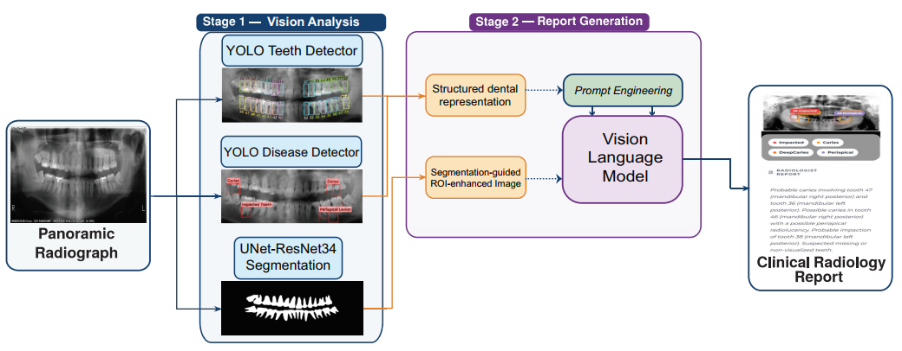

# Dental Report Generation from Panoramic Radiographs

This repository contains the research code and experimental notebooks for
automated dental report generation from panoramic dental radiographs using
structured visual analysis and pretrained Vision-Language Models (VLMs).

## Overview

The proposed framework consists of two main stages, as illustrated in
Figure 1.



### Stage 1: Vision Analysis

The first stage extracts clinically relevant information from panoramic
dental radiographs using dedicated deep learning models:

- **Tooth detection and FDI numbering:** A YOLO-based detector for tooth
  localization and FDI identification.
- **Dental pathology detection:** A YOLO-based detector for dental
  pathology detection.
- **Tooth segmentation:** A U-Net with a ResNet34 encoder for tooth
  segmentation and the construction of segmentation-guided
  region-of-interest (ROI) representations.

The outputs of the vision-analysis models are subsequently combined into
structured clinical information used to guide the report-generation stage.

### Stage 2: Vision-Language Report Generation

The extracted visual and structured clinical information is provided to
pretrained Vision-Language Models through carefully designed multimodal
prompts. Multiple VLMs and multimodal input configurations are evaluated
for automated dental report generation without additional VLM fine-tuning.

### Evaluated Vision-Language Models

The following pretrained Vision-Language Models were evaluated for dental
report generation:

| Model | Vision Encoder | Visual Tokens | Language Decoder | Total Params. | Context | Quant. |
|---|---|---:|---|---:|---:|---|
| SmolVLM2-2.2B | SigLIP SO400M | Dynamic | SmolLM2-1.7B | ~2.2B | 8,192 | 4-bit NF4 |
| Qwen2-VL-2B | ViT 675M | Dynamic | Qwen2-1.5B | ~2.0B | 32,768 | FP16 |
| Qwen2.5-VL-3B | ViT + Window Attn. | Dynamic | Qwen2.5-2.7B | ~3.0B | 32,768 | FP16 |
| InstructBLIP-7B | EVA-CLIP ViT-G/14 | 32 | Vicuna-7B | ~8.2B | 2,048 | 4-bit NF4 |
| LLaVA-1.5-7B | CLIP ViT-L/14@336 | 576 | Vicuna-7B | ~7.3B | 4,096 | 4-bit |

The report-generation stage includes both automated and expert-based
evaluation of the generated reports.

## Repository Structure

```text
dental-report-generation/
│
├── stage1_vision/
│   ├── tooth_detection/
│   │   └── Yolo_teeth.ipynb
│   │
│   ├── pathology_detection/
│   │   └── Yolo-disease.ipynb
│   │
│   └── segmentation/
│       └── U-Net-ResNet34.ipynb
│
├── stage2_report/
│   ├── Expert Evaluation.ipynb
│   ├── LLM-as-a-Judge Evaluation.ipynb
│   
│
├── figures/
│   └── framework.png
│
├── requirements.txt
├── README.md
├── LICENSE
└── .gitignore
```

## Models


The trained model weights are available from the following repositories:

- **YOLO-Teeth:** Contact us at [aboulesnane@univ-constantine3.dz](mailto:aboulesnane@univ-constantine3.dz)
- **YOLO-Disease:** Contact us at [aboulesnane@univ-constantine3.dz](mailto:aboulesnane@univ-constantine3.dz)
- **U-Net-ResNet34:** Contact us at [aboulesnane@univ-constantine3.dz](mailto:aboulesnane@univ-constantine3.dz)


## Datasets

The experiments use the following publicly available dental imaging
datasets:

- **DENTEX:** [Hugging Face Dataset](https://huggingface.co/datasets/ibrahimhamamci/DENTEX)
- **Niihhaa:** [Zenodo Dataset](https://zenodo.org/records/10538750)
- **ADCD:** [Zenodo Dataset](https://zenodo.org/records/15487430)

The datasets are not included in this repository. Users should download
or access the datasets from their respective sources and configure the
required paths in the Kaggle environment before running the notebooks.

## Experimental Environment

The experimental notebooks were developed and executed using the
[Kaggle](https://www.kaggle.com/) GPU environment.

The notebooks are retained in Jupyter Notebook format, including their
saved outputs, to document the experimental procedures and results used
in the study.

## Running the Notebooks

The notebooks are intended to be executed in a Kaggle GPU environment.

Before running the notebooks:

1. Clone this repository into the Kaggle environment.
2. Attach the required datasets to the Kaggle notebook.
3. Configure the required dataset paths.
4. Configure API credentials through Kaggle Secrets where required.
5. Install the required dependencies.
6. Run the notebooks according to the corresponding stage of the
   framework.

Environment-specific paths and configurations may need to be adjusted
according to the Kaggle environment.


## Citation

If you use this code or the proposed framework in your research, please
cite the associated article:

```bibtex
@Article{electronics4578185,
AUTHOR = {Abdennour Boulesnane, Farah Bouart, Souham Meshoul, Rabah Boussalia, Mohamed Batouche, Ismahane Lebeze and Imen Benhamada},
TITLE = {A Dual-Stage Vision-Language Framework for Dental Report Generation},
JOURNAL = {Electronics},
VOLUME = {},
YEAR = {2026},
NUMBER = {},
ARTICLE-NUMBER = {},
URL = {https://www.mdpi.com/},
ISSN = {},
DOI = {}
}
